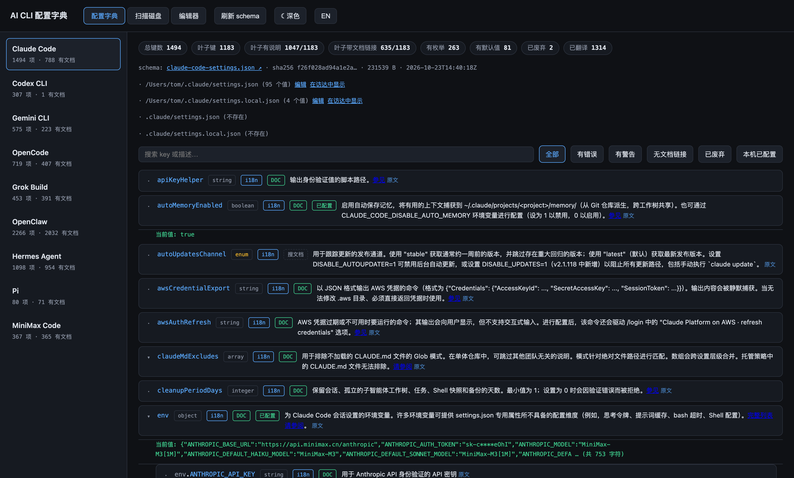
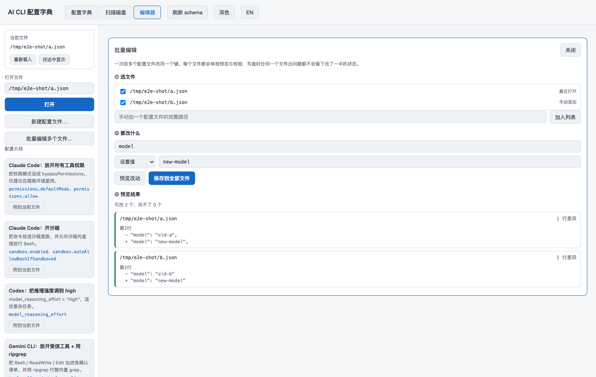
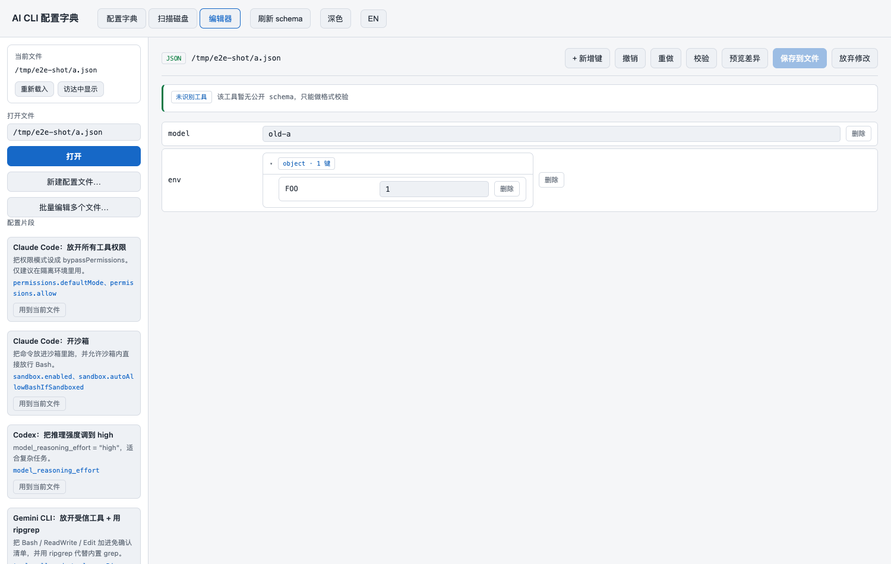

# AI CLI 配置字典

[](https://github.com/gztcode/ai-cli-config-dictionary/actions/workflows/ci.yml)
[](https://github.com/gztcode/ai-cli-config-dictionary/releases/latest)
[](LICENSE)
[](https://www.rust-lang.org/)

**AI CLI 的配置项字典。**

把 Claude Code、Codex CLI、Gemini CLI、OpenCode、OpenClaw、Hermes、Pi、Grok Build、MiniMax Code
九家 AI 命令行工具的**全部配置项**、官方说明与文档链接，收进一个可搜索、可校验、可编辑的桌面应用。



---

## 这是什么

用 AI CLI 的人越来越多，每家的配置文件却各写各的：有的在 `~/.claude/settings.json`，
有的在 `~/.codex/config.toml`，有的在 `~/.opencode/opencode.json`。
键叫什么、类型是什么、默认值多少、能填哪些枚举值 —— 全靠翻官方文档，
而官方文档还常常一页里塞几十个字段，或者干脆只有一句散文。

这个应用把这件事变成查表：

- **配置字典** —— 九家工具的全部 key，带类型、官方说明、文档链接、枚举、默认值、是否废弃；
  说明**全量中文化**（3145 条），搜中文、搜英文、搜枚举值都能找到
- **扫描磁盘** —— 一次遍历找出本机所有项目里的 AI CLI 配置文件，按项目分组
- **编辑器** —— 点开就能改：新增键、增删数组元素、撤销重做、保存前按 schema 校验、
  预览逐行差异，**保格式写回**（缩进、注释、键顺序原样不动）

**不编造。** 键位、类型、默认值、说明只从官方来源取：官方发布的 schema、
官方文档里的字段表、官方仓库里的类型定义。取不到就明说取不到，
不拿猜测去凑，也不伪造文档锚点。

---

## 能干什么

| 能力 | 说明 |
|---|---|
| **配置字典** | 5661 个叶子键，九家工具全覆盖；每个键带类型、说明、文档链接、枚举、默认值、废弃标记 |
| **全量中文** | 3145 条官方说明 100% 有中文译文，术语表保证全库一致 |
| **文档链接三级降级** | 精确锚点 → 章节级锚点（拿 schema 的真实键去官方文档里反查）→ 「搜文档」入口（官方文档索引页 + 自动复制搜索词）。72% 的叶子键带文档链接 |
| **说明里不摆裸 URL** | 「参见 https://…」里的地址本身不显示，**前面那个原文词变成可点链接** |
| **扫描磁盘** | 一次遍历产出「项目」和「项目里的 AI CLI 配置文件」；按项目分组，可按工具筛选 |
| **编辑器** | 新增键、增删数组元素、撤销重做、外部改动冲突检测、保存前 schema 校验、逐行差异预览 |
| **保格式写回** | JSON / JSONC / TOML / YAML 各按自己的格式写，缩进、注释、键顺序、YAML 锚点都原样保留 |
| **密钥脱敏** | API key / token 这类字段默认打码，点「显示明文」才取真值；脱敏在服务端完成，明文不进 WebView、不进导出文件 |
| **批量改多个文件** | 一次给十几个项目的同一份配置加同一个键：逐文件预览，任一文件被改过则**整批不写** |
| **配置片段库** | 预置常用配置组合（放开权限、开沙箱、调推理强度…）一键应用；也能把当前改动存成片段 |
| **托盘常驻** | 关窗口不退出，菜单栏图标常驻，随时唤起 |
| **全局快捷键** | `Cmd/Ctrl+Shift+C` 唤起窗口，`+Shift+F` 聚焦搜索；窗口内还有 `F` 搜索、`S` 保存、`Z` 撤销 |
| **深色 / 浅色** | 默认跟随系统，手动切过之后记住你的选择 |



---

## 下载

从 [Releases](https://github.com/gztcode/ai-cli-config-dictionary/releases/latest) 下载：

| 平台 | 文件 |
|---|---|
| macOS (Apple Silicon) | `AI-CLI-Config-Dictionary-aarch64-apple-darwin.dmg` / `.zip` |
| macOS (Intel) | `AI-CLI-Config-Dictionary-x86_64-apple-darwin.dmg` / `.zip` |
| Windows (x64) | `AI-CLI-Config-Dictionary-x86_64-pc-windows-msvc.msi` |
| Linux (x64) | `AI-CLI-Config-Dictionary-x86_64-unknown-linux-gnu.deb` / `.AppImage` |

同一页还附有纯 Rust 的命令行版 `cfg-explorer-<target>`（无 GUI 依赖，可在服务器上跑）。

> macOS 包未做代码签名，首次打开需要「右键 → 打开」；Windows 包未签名，SmartScreen 可能提示。

---

## 快速上手

1. **下载并打开。** 首次启动会联网抓一次各家 schema（不到 1 MB），之后走本地缓存。
2. **查配置项。** 在「配置字典」页选左边的工具，搜索框里输入键名、说明里的词，
   或者某个枚举值（比如 `bypassPermissions`）。
3. **找到本机的配置文件。** 到「扫描磁盘」页选范围（用户目录 / 项目目录 / 全盘），
   结果按项目分组。
4. **改一下。** 点配置文件后面的「编辑」，在编辑器里改值 —— 改完点「校验」看有没有问题，
   点「预览差异」看逐行改动，确认无误再「保存到文件」。

常用快捷键：`Cmd/Ctrl+F` 搜索、`Cmd/Ctrl+S` 保存、`Cmd/Ctrl+Z` 撤销、`Esc` 关面板。



---

## 命令行版

没有 GUI 也能用（CI、服务器、脚本里）：

```bash
cfg-explorer discover          # 本机各工具配置现状
cfg-explorer fetch             # 拉取 schema 到本地缓存
cfg-explorer check             # 用真实配置跑一遍校验
cfg-explorer scan --root ~/Projects --content-scan   # 扫描磁盘找配置文件
cfg-explorer edit ~/.claude/settings.json --set 'model=claude-opus-4' --dry-run
cfg-explorer preview           # 导出单文件 HTML（离线可看）
cfg-explorer serve             # 起 HTTP 桥：真实前端 + 真实命令
```

源码用 Rust 写，`cargo build --release` 即可。运行时依赖只有 serde / serde_json / toml /
serde_yaml / ureq / regex / sha2 / clap / anyhow / dirs 这些，没有别的。

---

## 数据从哪来

| 工具 | 来源 | 叶子键 | 叶子带文档链接 |
|---|---|---|---|
| Claude Code | SchemaStore 官方 schema | 1183 | 635 |
| Codex CLI | 官方仓库 `openai/codex` | 296 | 1 |
| Gemini CLI | 官方仓库 `google-gemini/gemini-cli` | 399 | 177 |
| OpenCode | 官方 `opencode.ai/config.json` | 576 | 344 |
| Grok Build | 官方文档字段表派生 | 384 | 384 |
| OpenClaw | 官方 npm 包 Zod schema + 12 个官方文档页 | 1553 | 1410 |
| Hermes Agent | 官方仓库 `config_defaults.py` 派生 | 926 | 819 |
| Pi | 官方 npm 包 `docs/settings.md` 派生 | 71 | 71 |
| MiniMax Code | 官方仓库 `packages/config/src/**` 派生 | 273 | 271 |

合计 **5661 个叶子键**，**4112 个（72%）带文档链接**。

> Codex 官方文档站（`developers.openai.com`）在本机沙箱里被 Cloudflare 挡（403），
> 所以它的链接覆盖几乎为零 —— 走「搜文档」降级入口，你在浏览器里能正常打开。

---

## 文档

架构、IR 数据契约、schema 来源与派生流程、实测数据，以及开发过程中踩过的坑，
都写在 **[工程笔记](docs/工程笔记.md)** 里。

---

## 已知限制

- **Codex 官网 schema 被 Cloudflare 挡** —— 改用官方仓库里的同一份，内容等价。
- **5 家是派生 schema**（Grok Build / Pi / Hermes / OpenClaw / MiniMax Code）——
  键位真实，但可能随上游更新而滞后，重跑 `tools/derive_schema.py` 即可更新。
- **密钥不写系统钥匙串** —— 目前只做显示脱敏，配置文件里的密钥仍是明文存着。
- **翻译是机器翻译** —— 术语表保证了术语一致，长句偶有生硬。
- **`anyOf` 只做保守归约** —— 不会误报，但也查不出缺字段。
- **macOS 受 TCC 保护的目录扫不到** —— `~/Library` 下部分目录会被系统拒绝访问，静默跳过。

---

## License

[MIT](LICENSE)　·　用 Rust + Tauri 2 写的，界面是原生窗口，不是网页。
